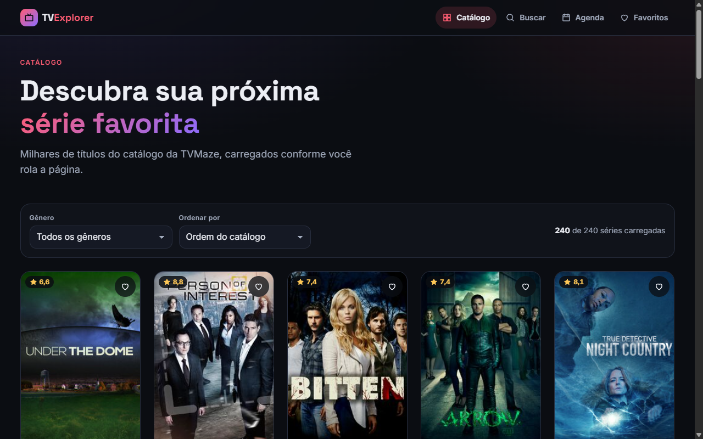

# TV Explorer

**Português:** [README.md](README.md)

TV show explorer built with **Angular 20** and the public, keyless [TVMaze API](https://www.tvmaze.com/api). Browse thousands of shows with infinite scroll, filter by genre and sort by rating, search as you type with RxJS, open a show to see its summary, seasons, episodes and cast, keep favorites in the browser and check today's schedule by country. The UI is available in Portuguese (default) and English.

**Live demo:** https://portfolio.brunoisaac.dev/angular-tv-explorer/



## Features

- Infinite-scroll catalog (`/shows?page=N`) using a custom `IntersectionObserver` directive.
- Genre filter and rating/name sort on the shows already loaded. The catalog state survives navigation.
- Reactive search with `debounceTime`, `distinctUntilChanged` and `switchMap`, synced with `?q=`.
- Show page: sanitized summary, rating, genres, seasons with lazily loaded episodes, and a cast section rendered with `@defer (on viewport)`.
- Favorites stored in `localStorage` by a Signals-based store, synced across tabs.
- Today's schedule (`/schedule`) grouped by airtime, with country/date as query params bound to inputs.
- Functional HTTP interceptor with retry and exponential backoff, plus accessible toasts.
- Loading skeletons, empty and error states, a dark theme, a responsive layout and accessible controls.
- **i18n (pt-BR / English)** with Transloco: Brazil/USA flag buttons in the header (an accessible radio group), the choice saved in the browser, translations lazy-loaded per feature, and dates/numbers in the active locale.

## Stack

Angular 20.3 (standalone components, Signals, new control flow), TypeScript 5.9 (strict), RxJS 7.8, Transloco 8.2, SCSS, Karma + Jasmine, ESLint (angular-eslint) and Prettier.

## Architecture

- `core/` holds singletons (API client, interceptor, favorites store, layout, i18n), `shared/` holds reusable UI, and each `features/<name>/` has its own `*.routes.ts`, `pages/`, `components/` and `data-access/`.
- Every feature is lazy loaded (`loadChildren` + `loadComponent`), and each feature's providers and translation scope live in its route.
- Signals hold state and RxJS handles async flows, bridged with `toSignal`.

## Internationalization

- Root translations live in `public/i18n/{pt-BR,en}.json`; each feature scope lives in `public/i18n/<feature>/{pt-BR,en}.json` and is loaded with the feature.
- The initial language is the saved choice, then the browser language (`pt*` → pt-BR, otherwise en), then pt-BR. It is applied before the first render and updates `<html lang>`.
- TVMaze genres, show status and show types are translated in both languages. Summaries and episode names stay as the API returns them.
- To add a language, extend `src/app/core/i18n/i18n.config.ts`, register its Angular locale in `provide-i18n.ts`, add the JSON files and include them in `src/testing/transloco-testing.ts`.

## Running locally

```bash
npm install
npm start            # http://localhost:4200
npm run test:ci      # unit tests (ChromeHeadless)
npm run lint
npm run build
npm run build:cf     # production build under /angular-tv-explorer/ (dist/angular-tv-explorer/browser)
```

## Deploy

Published on Cloudflare (Workers static assets) at https://portfolio.brunoisaac.dev/angular-tv-explorer/ by the pipeline in the [portfolio](https://github.com/BrunoICosta/portfolio) repository. This repository only runs CI (lint, formatting, tests and build).

## Author

Bruno Vinicius Isaac Costa · https://github.com/BrunoICosta · MIT License · Data by [TVMaze](https://www.tvmaze.com/) (CC BY-SA 4.0).
