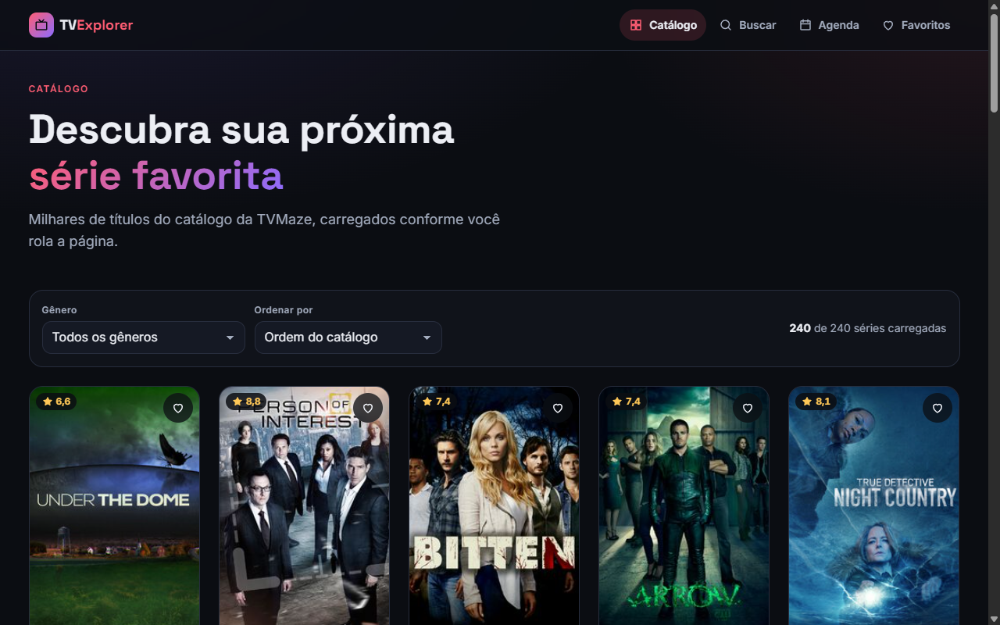

# TV Explorer

[](https://github.com/BrunoICosta/angular-tv-explorer/actions/workflows/ci.yml)
[](https://github.com/BrunoICosta/angular-tv-explorer/actions/workflows/deploy.yml)


Catálogo de séries de TV feito com **Angular 20** e a API pública da [TVMaze](https://www.tvmaze.com/api) (sem chave). Navegue por milhares de séries com rolagem infinita, filtre por gênero e ordene por nota, busque com RxJS enquanto digita, veja sinopse, temporadas, episódios e elenco de cada título, salve favoritas no navegador e consulte a agenda do dia por país. O projeto usa componentes standalone, Signals, o novo control flow (`@if`/`@for`/`@switch`/`@defer`), lazy loading em todas as features e um design escuro próprio, sem biblioteca de UI.

**Demo:** https://brunoicosta.github.io/angular-tv-explorer/



## Funcionalidades

- **Catálogo com rolagem infinita**: diretiva própria com `IntersectionObserver` que pagina `/shows?page=N` e revela os cards em blocos de 48 para não renderizar 250 itens de uma vez.
- **Filtro por gênero e ordenação** (maior/menor nota, nome) sobre os resultados já carregados; o estado do catálogo sobrevive à ida e volta para a página de detalhes.
- **Busca reativa**: `debounceTime`, `distinctUntilChanged` e `switchMap` (requisições antigas são canceladas), termo sincronizado em `?q=` e opção de tentar de novo em caso de erro.
- **Detalhes da série**: sinopse com HTML sanitizado, nota, gêneros traduzidos, emissora, horário, temporadas em acordeão com episódios carregados sob demanda e elenco carregado com `@defer (on viewport)`.
- **Favoritos** guardados em `localStorage` por uma store baseada em Signals, com sincronização entre abas e validação dos dados salvos.
- **Agenda de hoje** (`/schedule`) agrupada por horário, com seleção de país e data via query params (`?pais=BR&data=2026-02-21`) e destaque do que já foi exibido.
- **Tratamento de erros HTTP**: interceptor funcional com retry e backoff exponencial para falhas de rede, 429 e 5xx, erros normalizados e avisos (toasts) acessíveis.
- **Skeletons de carregamento**, estados vazios e de erro em todas as telas.
- Tema escuro, layout responsivo (mobile first), foco visível, link "pular para o conteúdo", `aria-*` nos controles e respeito a `prefers-reduced-motion`.
- Título da aba e meta description por página.

## Stack

| Tecnologia | Versão |
| --- | --- |
| Angular (standalone, Signals, control flow) | 20.3 |
| Angular CLI / `@angular/build` (esbuild) | 20.3.15 |
| TypeScript (strict) | 5.9 |
| RxJS | 7.8 |
| SCSS | — |
| Karma + Jasmine (ChromeHeadless) | 6.4 / 5.9 |
| ESLint + angular-eslint + typescript-eslint | 9.39 / 20.7 / 8.54 |
| Prettier | 3.8 |

## Arquitetura e decisões

```
src/app/
  app.component.ts   app.config.ts   app.routes.ts
  core/        singletons: api client, interceptor, favorites store, layout (header/footer/toasts),
               storage, title strategy, clock
  shared/      componentes de UI reutilizáveis, diretiva de infinite scroll, pipes, utils
  features/
    catalog/      catalog.routes.ts · pages/ · data-access/catalog.store.ts
    search/       search.routes.ts  · pages/ · data-access/search-stream.ts
    show-detail/  show-detail.routes.ts · pages/ · components/ · data-access/
    favorites/    favorites.routes.ts · pages/
    schedule/     schedule.routes.ts · pages/ · components/ · data-access/
    not-found/
```

- **Lazy loading em tudo**: `app.routes.ts` só conhece os pontos de entrada (`loadChildren` → `*.routes.ts`) e cada página usa `loadComponent`. O shell não importa nenhum componente de feature. O build de produção gera chunks separados por feature:

  | Chunk lazy | Tamanho (bruto / transferido) |
  | --- | --- |
  | `search-page-component` | 28,9 kB / 7,4 kB |
  | `show-detail-page-component` | 20,0 kB / 5,8 kB |
  | `schedule-page-component` | 11,0 kB / 3,7 kB |
  | `catalog-page-component` | 6,6 kB / 2,2 kB |
  | `favorites-page-component` | 5,0 kB / 1,8 kB |
  | `cast-list-component` (`@defer`) | 3,4 kB / 1,4 kB |
  | `not-found-page-component` | 1,1 kB / 0,6 kB |
  | `*-routes` (um por feature) | < 0,4 kB cada |

  O bundle inicial fica em ~107 kB transferidos. `PreloadAllModules` baixa as outras features em segundo plano depois que a primeira tela carrega.
- **Providers por feature**: `CatalogStore`, `SeasonEpisodesService` e `ScheduleService` são declarados no `providers` da rota, então chegam junto com o chunk. Como o injector da rota vive mais que o componente, o catálogo mantém páginas, filtros e rolagem ao voltar de uma série.
- **Signals para estado, RxJS para fluxos assíncronos**: stores e componentes usam `signal`/`computed`/`linkedSignal`; buscas, paginação e recargas usam operadores RxJS e chegam ao template via `toSignal`. A lógica da busca é uma função pura (`searchStream`) testada com marble tests.
- **Input binding do router** (`withComponentInputBinding`): `:id` da série e os query params da agenda chegam como `input()` nos componentes, sem `ActivatedRoute`.
- **Interceptor funcional** concentra retry/backoff e a tradução dos erros para pt-BR. O 404 do catálogo (fim das páginas) é esperado e não gera aviso.
- **Segurança**: os resumos da API passam pelo `DomSanitizer` (pipe `sanitizeHtml`) antes do `[innerHTML]`; só os campos necessários vão para o `localStorage`.
- **Testabilidade**: `localStorage` e "agora" são injetados por tokens (`BROWSER_STORAGE`, `CLOCK`), o que deixa store e agenda determinísticas nos testes.
- **Convenções**: arquivos com sufixo de tipo (`*.component.ts`, `*.service.ts`, `*.store.ts`, `*.routes.ts`...), `OnPush` em todos os componentes, `inject()`, `input()`/`output()`/`model()`, bindings de host no objeto `host`, `NgOptimizedImage` para pôsteres. Tudo isso é checado pelo ESLint.
- **Sem biblioteca de UI**: design system pequeno com tokens CSS (`src/styles/_tokens.scss`) e utilitários globais, para manter o bundle enxuto e o visual próprio.

## Como rodar

Pré-requisitos: Node.js 22 e npm 10.

```bash
npm install
npm start                 # http://localhost:4200
```

Outros scripts:

```bash
npm test                  # Karma em modo watch
npm run test:ci           # uma execução em ChromeHeadless
npm run lint              # ESLint (TS + templates + acessibilidade)
npm run format:check      # Prettier
npm run build             # build de produção em dist/
```

O deploy no GitHub Pages é feito pelo workflow `deploy.yml` com `ng build --base-href /angular-tv-explorer/`, copiando `index.html` para `404.html` para o roteamento da SPA funcionar.

## Possíveis próximos passos

- Ordenar e filtrar a busca (hoje a TVMaze devolve no máximo 10 resultados por termo).
- Página de pessoa (`/people/:id`) com a filmografia do ator.
- Modo claro com troca de tema persistida.
- Testes end-to-end com Playwright cobrindo os fluxos principais.
- Service worker para uso offline dos favoritos.

## Autor

Bruno Vinicius Isaac Costa — https://github.com/BrunoICosta

Dados fornecidos pela [TVMaze](https://www.tvmaze.com/) sob licença [CC BY-SA 4.0](https://creativecommons.org/licenses/by-sa/4.0/). Licença do código: [MIT](LICENSE).
